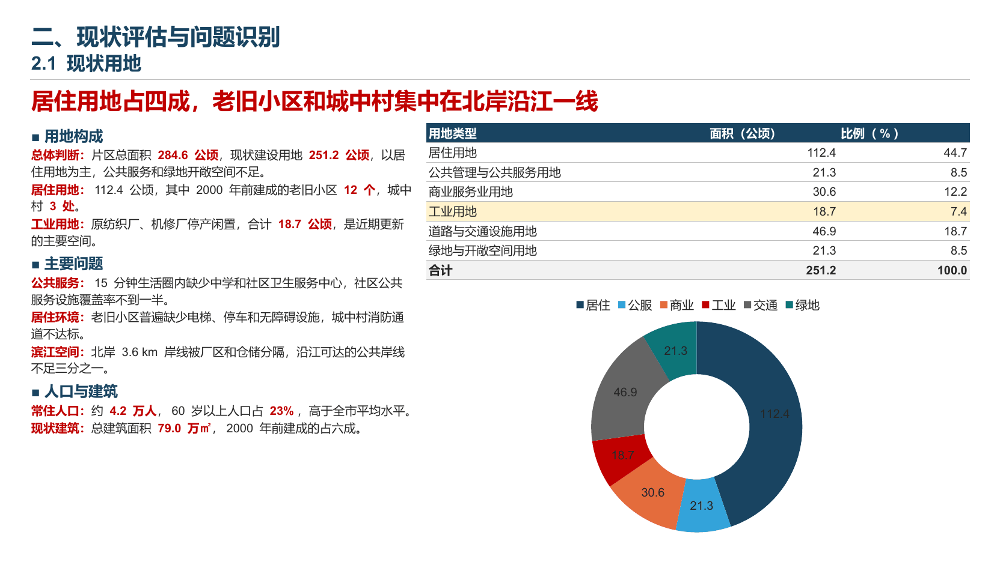
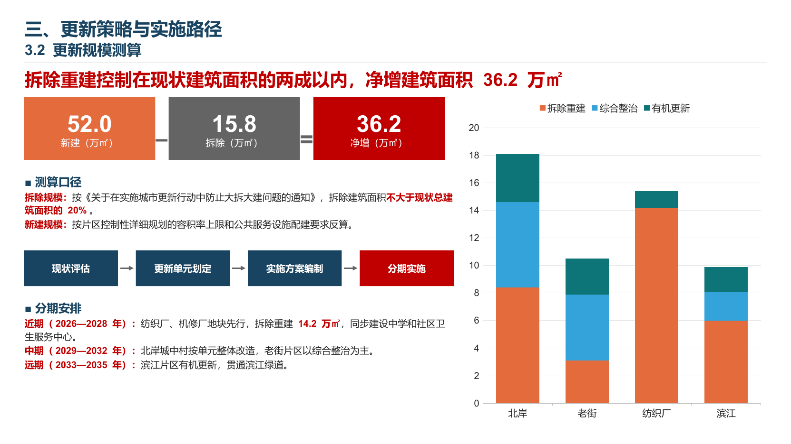

<div align="center">

# plan-deck

**让 AI agent 按规划汇报的逻辑出可编辑的 PPT。**

面向 Claude Code、Codex 等 agent 的 skill，附一个 Python 运行时。

[](LICENSE)
[](pyproject.toml)
[](SKILL.md)

</div>

---

## 这是什么

我做国土空间规划、城市更新这类工作，经常要给主管部门、领导或评审专家做汇报。让 agent 用通用的 PPT skill 来做，出来的东西总是不对劲：一页一个观点、大字留白、卡片加渐变，看着像产品发布会。规划汇报的听众要逐页核对，一页三四百字是常态；结构是一级级展开的标题树，不是讲故事；地图是证据，数字前后要对得上，说法要有上位依据；稿子还要在同事之间来回改。

规划院自己做的汇报，逻辑往往很扎实，但人手有限，版式和视觉很难达到国际咨询文本的水准。plan-deck 想做的是两者结合：**规划院汇报的逻辑，加上国际咨询文本的视觉品质**。

它分两部分：

- **skill 文档**（[SKILL.md](SKILL.md) 和 [docs/](docs/)）：工作流和判断规则。先写结构大纲给人过目，一个叶节点做一页，页面标题就是节点名；从固定的几种版式里选，不自由摆放；页面不写讲解员口吻、免责和待定核查用语；同事的稿子先查版面外的内容。
- **运行时**（`src/plan_deck/`）：把容易悄悄出错的事交给代码。颜色、字号、栏位只能按名字从项目的 `style.json` 里取，写错就报错；生成的形状统一命名，改稿时按名字定位，不认识的元素不动；出页后有检查、渲染和出交付副本的命令。

产出是原生 `.pptx`：文字是文本框，表格是表格，图表是 PowerPoint 图表，同事可以接着在 PowerPoint 或 WPS 里改。





<sub>两页示例用的是虚构项目「江屿市北岸老城片区城市更新统筹规划」，数字都是编的。由 [examples/sample_deck.py](examples/sample_deck.py) 按 [examples/style.json](examples/style.json) 生成，用 LibreOffice 渲染。</sub>

## 能做什么

### 1. 按规划汇报的规矩组织内容

- **结构大纲**：每份 pptx 旁边有一份同名的 `.outline.md`，章、节、条一级级展开，一个叶节点一页。agent 先写大纲和页面计划交人过目，节点名、层级和顺序由人定，agent 不自己改。
- **页型和版式**：页型库列了政策摘录、现状实证、账算式、方案比选、规模测算等几十种页面（[page-types.md](docs/page-types.md)）；版式只有图文二分、满版图、图示、表格、多栏并列、多图组六种（[visual-language.md](docs/visual-language.md)）。
- **页面文字**：每页一行红字结论、放大的重点、密集的次要信息三层；正文按条目标红；不写“本页讲什么”这类讲解员的话，不写“仅供参考”“待定”这类免责和核查用语。规则都配了正反例。
- **定稿后去 AI 味**：工具出的稿子过于整齐。用户说定稿以后，另存一版按内容换色、定形，工作稿保留（[humanize.md](docs/humanize.md)）。

### 2. 项目视觉系统和页面组件

- **`style.json`**：页面尺寸、版心、12 栏网格、页眉、字号阶梯、按含义命名的颜色和类别配色，一个项目一份，全册共用。`plan-deck style check` 校验，页面上比正文小的字、正文低于投影可读下限都会报错。
- **组件**：页眉、红字结论、正文块、表格、原生图表、账算式、图示节点和箭头、图片、讲稿备注。接口一律用厘米，按字宽估算放不放得下，放不下记警告，不悄悄缩字。
- **接着改已有的稿子**：`Deck.open()` 打开别人的 pptx 继续用组件；`replace_text` 按段落替换文字，处理跨 run、中文标点断行这些坑。

### 3. 地图交给 gis 系列

plan-deck 不画地图。空间分析交给 [gis-kit](https://github.com/shioo-gis/gis-kit)，出图交给 gis-composer（我的另一个项目，还没公开）。plan-deck 只读 gis-composer 的发布版：核对文件哈希，按地图的打印尺寸原样放图，把图例画成可编辑的形状；地图主题的颜色和字体与页面对不上、发布版带着没过的 QA 时给警告。地图类型和分工见 [map-types.md](docs/map-types.md)。

### 4. 检查和交付

| 命令 | 做什么 |
|---|---|
| `plan-deck inspect` | 每次出页后跑：小字、形状重名、画布外对象、页面绝不出现的用语报为问题；讲解员口吻、字放不下、等尺寸模块等给警告 |
| `plan-deck audit` | 定稿前的只读体检：全册版面指标、逐页标记；`--against` 逐页比两版文字 |
| `plan-deck offcanvas` | 接手同事的稿子时先跑：列出版面外和跨边对象的全部内容，导出图片，标出版面内外两版对不上的表格 |
| `plan-deck render` | 用 LibreOffice 或 PowerPoint（macOS）转 PDF 和逐页 PNG，列出实际嵌入的字体 |
| `plan-deck clean` | 另存交付副本：清掉备注里的改稿说明、待确认和内部说法，页面不动 |
| `plan-deck maps check` | 逐张核对地图发布版 |

还没有的：结构大纲自动生成、页面池操作（取页、重排、隐藏）、封面目录等结构页。现在由 agent 在脚本里用 python-pptx 做，规则照样遵守。

## 快速开始

**1. 安装**：克隆到 agent 的 skills 目录，目录名保持 `plan-deck`。

```bash
# Claude Code
git clone https://github.com/shioo-gis/plan-deck.git ~/.claude/skills/plan-deck
# Codex
git clone https://github.com/shioo-gis/plan-deck.git ~/.codex/skills/plan-deck
```

**2. 准备 Python 环境**（Python 3.10 或更高），在仓库里建虚拟环境：

```bash
cd ~/.claude/skills/plan-deck
python3 -m venv .venv
.venv/bin/python -m pip install -e .
.venv/bin/python bin/plan-deck style check examples/style.json
```

**3. 直接对 agent 说**

> 用这个文件夹里的任务书和现状资料，给区自然资源局做一份城市更新规划的阶段汇报，16:9，先给我看大纲。
>
> 接手同事这份汇报稿，先查一遍版面外有没有任务说明，再按大纲把第三章改成三大策略加分项展开。
>
> 稿子定了，出一版去 AI 味的，再出一份发给甲方的交付副本。

agent 会读 [SKILL.md](SKILL.md)，按需查 `docs/` 里的规则，先定项目目录和视觉系统，写好大纲停下来让你看，再逐页出稿、渲染、检查。

## 运行环境

- **Python 依赖**：python-pptx 和 pillow，`pip install -e .` 会装好。用缺依赖的解释器运行 `bin/plan-deck` 时，它会报出缺哪个依赖、该用哪个解释器。
- **渲染**：`render` 和 `offcanvas --render` 需要 LibreOffice（`soffice`）；逐页 PNG 和字体清单需要 poppler 的 `pdftoppm`、`pdffonts`，没装时只出 PDF。LibreOffice 缺页面字体（如微软雅黑）时会换字或漏字，看图前先确认字体已安装或已做映射。
- **PowerPoint 核对**：macOS 上装了 Microsoft PowerPoint 时，`render --engine powerpoint` 让 PowerPoint 导出 PDF，交付前用它过一遍。第一次运行时 macOS 可能要求允许终端控制 PowerPoint。Windows 上还没有自动化。
- **地图**：放图需要 gis-composer 的发布版；`style.json` 写了 `mapTheme` 时，通过环境变量 `GIS_COMPOSER_CMD` 调 gis-composer 的命令行。不用地图时不需要。

Windows 的 PowerShell 里没有 `python3`，或者它只是应用商店的占位程序时，改用 `py -3`，解释器路径也不同：

```powershell
py -3 -m venv .venv
.venv\Scripts\python.exe -m pip install -e .
.venv\Scripts\python.exe bin\plan-deck style check examples\style.json
```

## 测试

```bash
cd tests && PYTHONDONTWRITEBYTECODE=1 ../.venv/bin/python -m unittest
```

测试只用虚构数据，产物写系统临时目录。真渲染默认跳过，设 `PLAN_DECK_RENDER_ENGINE=libreoffice` 或 `powerpoint` 才跑。

## 文档

| 文件 | 内容 |
|---|---|
| [SKILL.md](SKILL.md) | agent 的入口：工作流、要点、什么时候停下来问 |
| [docs/design-principles.md](docs/design-principles.md) | 规划汇报的特点，以及已定的设计决策和理由 |
| [docs/visual-language.md](docs/visual-language.md) | 视觉与版式：页面框架、版式清单、字号、配色、框和卡片、页面文字 |
| [docs/page-types.md](docs/page-types.md) | 页面类型库 |
| [docs/map-types.md](docs/map-types.md) | 地图类型目录，与 gis-kit、gis-composer 的分工 |
| [docs/humanize.md](docs/humanize.md) | 定稿后的去 AI 味收尾 |
| [docs/architecture.md](docs/architecture.md) | 运行时：`style.json`、结构大纲格式、对象命名、地图衔接、组件和命令 |

## 数据与隐私

运行时在本地读写 pptx，不联网（`render` 只调用本机的 LibreOffice 或 PowerPoint）。但 agent 读到的汇报内容会进入远端模型的上下文，涉密或未公开的材料请自己判断能不能交给 agent。

`offcanvas` 会把版面外、隐藏对象和备注的全部文字导出到输出目录，`clean` 出的交付副本也不动版面外的对象。分享这些文件前请先看一遍。

仓库里的示例和测试数据都是虚构的，不含真实项目的汇报。

## 许可证

[Apache License 2.0](LICENSE)

<sub>关键词：规划汇报 · PPT · PowerPoint · pptx · python-pptx · 国土空间规划 · 城市更新 · 控制性详细规划 · 城市设计 · 汇报稿 · AI agent · Claude Code skill · Codex skill · Agent Skills · LLM · 版式 · 视觉系统 · 城乡规划</sub>
